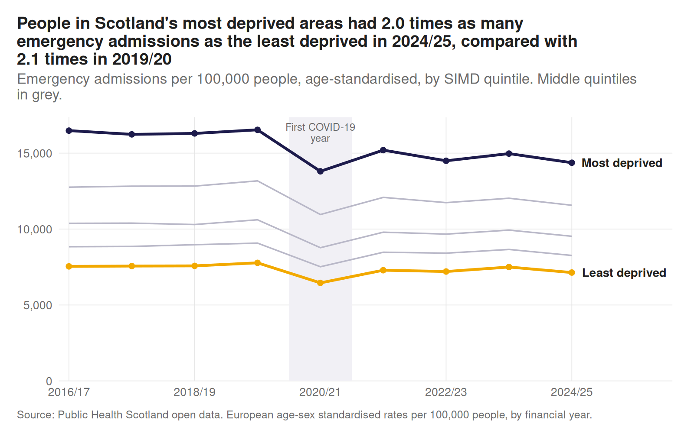
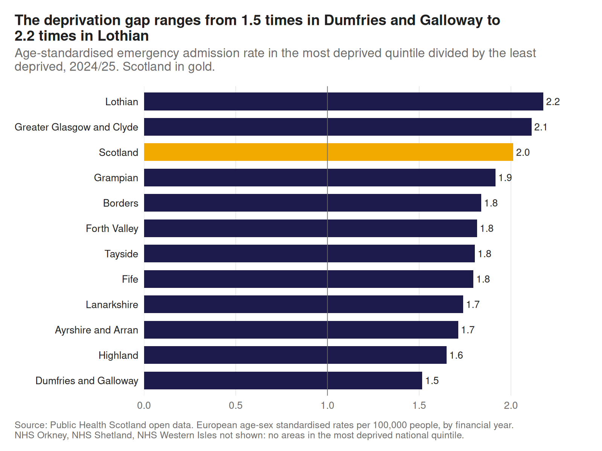
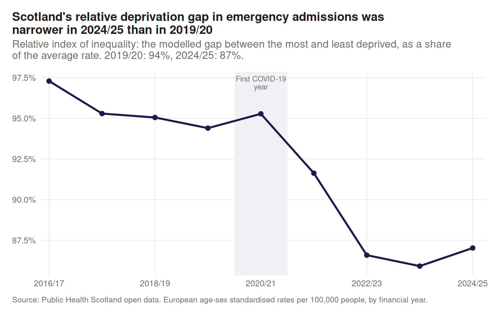
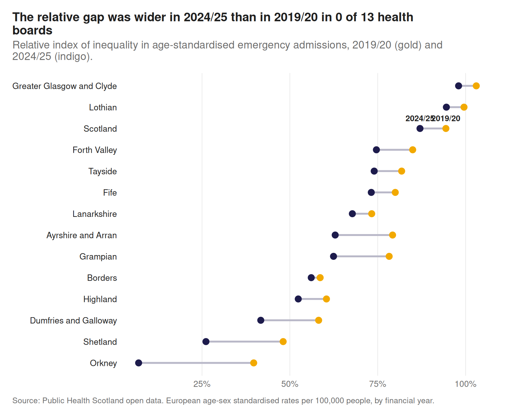
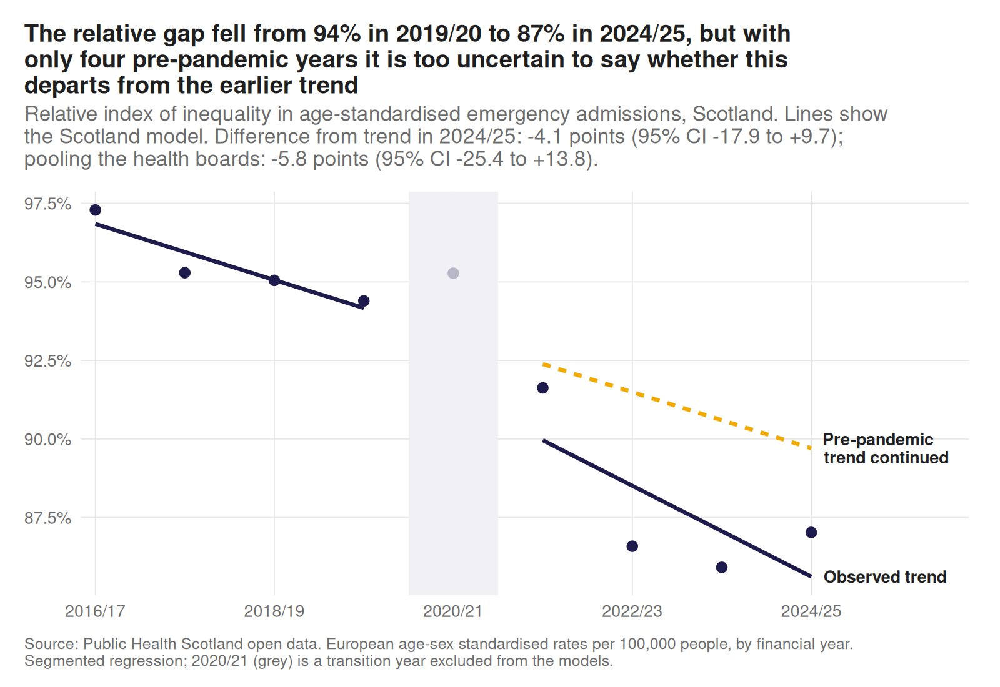

# Has the deprivation gap in emergency admissions changed since COVID?

People living in Scotland's most deprived areas are admitted to hospital as emergencies far more often than those in the least deprived areas. This project asks whether that gap has narrowed, widened or stayed the same since the COVID-19 pandemic, and how it differs across NHS health boards.

## Key findings

Comparing 2019/20 (the last full pre-pandemic year) with 2024/25 (the latest complete year), using age-standardised rates:

- **The gap is still large.** People in the most deprived fifth of Scotland had about twice as many emergency admissions as those in the least deprived fifth: 14,370 against 7,136 per 100,000, a rate ratio of 2.01.
- **It has narrowed a little, in absolute and relative terms.** The rate ratio fell from 2.13 to 2.01. The absolute gap between the two extreme quintiles fell from 8,759 to 7,232 per 100,000. The slope index of inequality fell from 10,790 to 8,840, and the relative index of inequality fell from 0.94 to 0.87.
- **Most of the narrowing comes from fewer admissions in deprived areas.** Rates in the most deprived quintile fell by about 2,200 per 100,000 (13%), compared with about 640 (8%) in the least deprived.
- **There is no clear evidence that the pandemic changed the direction of the gap.** The relative gap was already falling before 2020, by about 0.9 points a year. In 2024/25 it was 4.1 points below where that trend would have taken it (95% CI -17.9 to +9.7). The pooled health board model gives a similar result: -5.8 points (95% CI -25.4 to +13.8). All three models point the same way, but the intervals are wide and include no change. For the absolute gap (SII), only the pooled model's level change is borderline: -745 per 100,000 (95% CI -1,484 to -6, p = 0.048).
- **The gap narrowed in every mainland board, but by different amounts.** Dumfries and Galloway (1.84 to 1.52), Ayrshire and Arran (1.89 to 1.71), and Grampian (2.14 to 1.92) saw the biggest falls in the rate ratio. **Lothian (2.22 to 2.18) and Greater Glasgow and Clyde (2.19 to 2.11) changed least, and now have the widest gaps in Scotland.**
- **2025/26 provisional figures suggest the narrowing is continuing**, with a rate ratio of 1.93 and an RII of 0.81. These figures will be revised, and they are not used in the models.

## Interactive dashboard

**[Explore the dashboard](https://asantewaah.github.io/scotland-admissions-inequalities/)**: choose any NHS health board to see its emergency admission rates by deprivation and how the gap has changed. Built in Shiny and exported with [shinylive](https://posit-dev.github.io/r-shinylive/), so it runs entirely in the browser.

## Data

All from the [Public Health Scotland open data portal](https://www.opendata.nhs.scot):

| File | Source | Used for |
|---|---|---|
| `admissions_hb_simd_annual.csv` | [Inpatient and day case activity by board of residence and deprivation (annual)](https://www.opendata.nhs.scot/dataset/9e032286-e5bf-4eb0-837d-c0a05fe0d839/resource/249a9b22-8163-48db-ab3e-f33f3adf4c1e) | **Main analysis.** Age-standardised emergency admission rates by financial year (from 2016/17), health board and SIMD quintile |
| `admissions_hb_simd.csv` | [Inpatient and daycase activity by board of residence and deprivation (quarterly)](https://www.opendata.nhs.scot/dataset/inpatient-and-daycase-activity/resource/77d3d413-d7d6-4ad7-b89c-9e30ae75c64e) | Recent quarterly emergency admissions (from 2020Q4) for the dashboard |
| `simd2020v2_datazone.csv` | [SIMD 2020v2 lookup](https://www.opendata.nhs.scot/dataset/scottish-index-of-multiple-deprivation/resource/acade396-8430-4b34-895a-b3e757fa346e) | Assigning each data zone to a health board and deprivation quintile |
| `population_datazone.csv` | [Data zone population estimates](https://www.opendata.nhs.scot/dataset/population-estimates/resource/c505f490-c201-44bd-abd1-1bd7a64285ee) | Population by board and quintile, for quarterly rates and inequality weights |
| `hb_labels.csv` | [Health board codes and labels](https://www.opendata.nhs.scot/dataset/geography-codes-and-labels/resource/652ff726-e676-4a20-abda-435b98dd7bdc) | Health board names |

All are published under the [UK Open Government Licence](https://www.nationalarchives.gov.uk/doc/open-government-licence/version/3/). Raw data is downloaded by script and not stored in this repository. Each run records the source URL, portal update date and file checksum in `data/raw/download_log.csv`.

### Definitions and data notes

- **Two sources, two jobs.** The quarterly file only goes back to 2020Q4, so it cannot show the years before the pandemic. The main analysis therefore uses the annual file, which starts in 2016/17 and gives four pre-pandemic financial years. The quarterly file is used for a "recent quarters" view in the dashboard.
- **Emergency admission** means a continuous inpatient stay that began as an emergency admission (counted as stays rather than episodes, so transfers between specialties are not double counted).
- **Annual rates** are PHS European age-sex standardised rates per 100,000, so differences in age structure between deprived and less deprived areas do not distort the comparison. **Quarterly rates** are crude annualised rates per 100,000 (stays multiplied by four, divided by population), because the quarterly file is not broken down by age; they are not directly comparable with the annual rates.
- **Deprivation** uses Scotland-wide SIMD quintiles (1 = most deprived, 5 = least deprived). PHS assigns each admission to the SIMD release closest to its year. Population weights for the inequality measures use SIMD 2020v2, and the latest available population year for years beyond it.
- **Pre-pandemic comparison year** is 2019/20, which includes the first week of the March 2020 lockdown; its effect on the annual total is small.
- **Provisional data** (the latest financial year and quarter) are flagged, and provisional financial years are excluded from the analysis.
- Admissions with unknown deprivation (no valid postcode) are excluded; the cleaning script reports their share.
- The island boards (Orkney, Shetland, Western Isles) have no data zones in the most deprived national quintile, so their rate ratios cannot be calculated. Their slope and relative indexes are calculated from the quintiles they do have, when at least three are available.

## Approach

1. Download the data reproducibly from the PHS open data portal
2. Clean, check and build annual and quarterly analysis tables
3. Describe age-standardised emergency admission rates by deprivation quintile and health board over time
4. Measure inequality with the rate ratio, rate difference, slope index of inequality (SII) and relative index of inequality (RII)
5. Interrupted time series to test whether the gap shifted after the pandemic, compared with its pre-pandemic trend
6. Interactive dashboard to explore boards and quintiles

## Progress

- [x] Project setup
- [x] Data download
- [x] Cleaning and joining
- [x] Exploratory analysis
- [x] Inequality measures
- [x] Interrupted time series
- [x] Dashboard
- [x] Write-up of findings

## Results

### Emergency admission rates by deprivation, Scotland



### The gap in each health board



### Measuring the gap

The rate ratio compares only the two extreme quintiles. The **slope index of inequality (SII)** uses all five: each quintile is placed at the midpoint of its share of the population, ranked from most to least deprived, and a population-weighted regression of rates on that rank gives the modelled absolute gap between the most and least deprived ends of the population. The **relative index of inequality (RII)** divides the SII by the average rate, so the gap can be compared over time even as overall admission rates rise and fall.





### Did the pandemic shift the gap?

An interrupted time series compares the gap after the pandemic with where its pre-pandemic trend was heading. 2016/17 to 2019/20 are the pre-pandemic years; 2020/21 is treated as a transition year and left out, so the collapse in admissions during lockdown does not drive the estimates; 2021/22 onwards is post-pandemic.

Four pre-pandemic years is a short baseline, so three models are reported side by side:

| Model | What it assumes | Why it is included |
|---|---|---|
| Scotland: level and slope change | The gap can jump and change direction after the pandemic | The standard segmented regression, but a trend fitted to four points is fragile |
| Scotland: level change only | The gap can jump, but keeps its earlier trend | More stable when the baseline is short |
| Boards pooled: level and slope change | As the first model, fitted to every board at once with board fixed effects and standard errors clustered by board | Uses around ten times as much data to estimate the average shift within boards |

The headline is the difference between the observed gap and its pre-pandemic trend in the latest complete year, with a 95% confidence interval. The chart's title only claims a shift when all three models agree on its direction and the pooled estimate is clearly different from zero.



Full estimates are in `output/tables/its_results.csv` and `output/tables/its_effect_at_end.csv`. The headline numbers used in this README are collected in [`output/key_numbers.md`](output/key_numbers.md).

## Limitations

- **Short baseline.** Only four pre-pandemic years are available in the annual file, so the pre-pandemic trend is uncertain and the time series has little power to detect a shift. A null result here means "not enough evidence", not "no change".
- **Area-level deprivation.** SIMD describes the area a person lives in, not the person. Not everyone in a deprived area is deprived, and many deprived people live elsewhere, especially in rural boards. The results describe areas, not individuals.
- **Narrowing for the wrong reasons.** A smaller gap is only good news if it reflects better health. Fewer emergency admissions in deprived areas could also reflect changes in access, such as more care given in A&E without admission or longer waits. This analysis cannot tell these apart.
- **SIMD versions change over time.** PHS assigns each admission to the SIMD release closest to its year, so some areas move between quintiles across the series.
- **Island boards.** Orkney, Shetland and the Western Isles have no data zones in the most deprived quintile and small numbers, so their estimates are left out of the board comparison.
- **Observational design.** The time series compares observed values with an extrapolated trend. Anything else that changed after 2020, such as NHS winter pressures or new urgent care pathways, could explain part of the difference.

## Repository structure

```
R/                 analysis scripts, run in numbered order
data/raw/          downloaded data (not tracked)
data/processed/    cleaned data (not tracked)
output/figures/    charts used in this README
output/tables/     summary tables (rates, inequality measures, model results)
app/               Shiny dashboard (app.R and its data)
docs/              built dashboard served by GitHub Pages
```

## Reproducing the analysis

Requires R 4.3 or later. Package versions are pinned with [renv](https://rstudio.github.io/renv/).

From the project root:

```r
renv::restore()
```

```bash
Rscript R/01_download_data.R   # download raw data from PHS
Rscript R/02_clean_data.R      # clean, check and build annual and quarterly tables
Rscript R/03_explore.R         # rates by deprivation and first charts
Rscript R/04_inequality.R      # rate ratio, rate difference, SII and RII
Rscript R/05_its.R             # interrupted time series
Rscript R/06_dashboard_data.R  # small data files for the dashboard
Rscript R/07_build_dashboard.R # build the browser dashboard into docs/
Rscript R/08_key_numbers.R     # headline numbers for the write-up
```

Run the dashboard locally with `shiny::runApp("app")`.

## Author

Juliet Asantewaa Sarpong, PhD researcher in Statistics, University of Edinburgh. [Portfolio](https://asantewaah.github.io)
